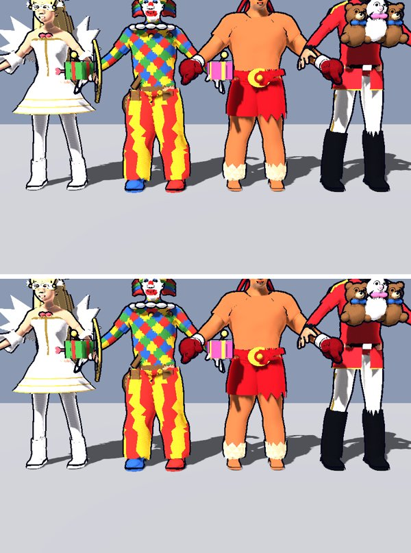
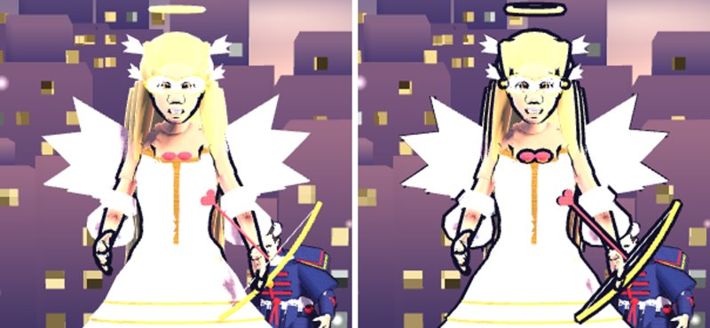

# 版103：軽量化② キャラの影と輪郭線をまとめる（描画の回数）（2026-10-21）

ユーザーの依頼（02:34）の②。画質と通信は下げない（02:47 ユーザー）。

## 原因（根拠つき）
- 実機（版100・iPhone・画質 high）：描画の回数と FPS が連動（編成 138回・ガチャ 178回 → 60 FPS、ロビー 414〜466回 → 46〜51、戦い 270〜389回 → 24〜45）。
- 描画の内わけ（`tools/perf_drawcensus.gd`・画質 high）：キャラ1人は、材質の数（10〜30面）×（色・輪郭線・影・輪郭線の殻の影）で描いていた。
  例：こぶし 21面 → 1人で約80回。輪郭線（材質の next_pass）は面ごと、影も面ごと、さらに輪郭線の殻も影を落としていた。

## したこと
- `scripts/core/skin_merge.gd`（新）：同じ骨で動く形の面を、1つの面にまとめる（点・法線・骨と重み。骨の表は1つにまとめ、ちがう表の小物は番号を付けかえる）。
  配列はエンジンの append_array でつなぐ（1人 13〜28 ms・PC。同じキャラの2人目からは使いまわして 1〜2 ms）。
- `scripts/characters/character_view.gd` の `build_proxies`：キャラごとに
  - **OutlineProxy**：輪郭線だけの形（面は最大3つ：不透明・両面の小物・切り抜き）。画質 high の時だけ出す。前と同じく影も落とす（前は線の殻も影を落としていたため）。
  - **ShadowProxy_back / _both**：影だけの形（不透明・片面／両面）。影の時だけ描く。
  - 元の形：輪郭線を付けない材質の写し（この形だけ）。不透明な形は影を落とさない（切り抜きの髪・まゆは、元のまま自分で落とす）。
- `style_fx.gd`：画質の切りかえでは、輪郭線の形を出す／隠すだけ。`ultimate_fx.gd`：必殺技の残像は、まとめた形を写さない。

## 結果（画質 high・llvmpipe・描画の回数）
| 場面 | 前 | 後 |
|---|---|---|
| キャラ4人だけ（同じ姿勢・同じ光） | 356 回 | **128 回**（−64%） |
| ロビー | 368〜375 回 | **236〜245 回**（−35%） |
| 戦い | 352 回 | **239 回**（−32%） |
| 9人の見こみ（色・線・影の合計） | 668 回 | 248 回 |

見た目：同じ姿勢・同じ光で撮ると、54万画素のうち差が出たのは 290 画素（0.05%・ふちの1画素ほど）。骨を動かした時の点の場所も、元の形と同じ（ずれ 0.00000 m）。

### 1つだけ見た目が変わる所
- **ロビーの小物（輪・弓・髪かざりなど）にも、輪郭線が付く**。前は、作る順番のせいで、ロビーでは小物に線が付いていなかった（戦いでは付いていた）。いまは戦いと同じ。

## 道具
- `tools/perf_drawcensus.gd`：描画の回数の内わけ（持ち主ごとの 面・輪郭線・影）。
- `tools/shot_char_ab.gd`：キャラ4人を同じ姿勢・同じ光で、まとめる前／後を撮る。`tools/shot_proxy_ab.gd`：ロビー・戦いで前／後。

## テスト
- test_v103（7）：9人全員の 形ができる・点の数・骨を動かした時の点の場所・2人目は使いまわす・画質の切りかえ・残像・描く回数の見こみ。test_characters（まとめた形は面の数に入れない）を合わせた。
- 全テスト：Godot 80本・Node 66件 合格。

## 残り（次）
- 戦いのボス（面12・線10・影11）、ロビーのうしろの町（Plaza・Tower：約40回）。
- 戦いで1コマだけ長くなる処理（実機の「しょりさいだい」80 ms）。

## 未計測
- 実機の FPS（`?perf=1` で見られる）。
