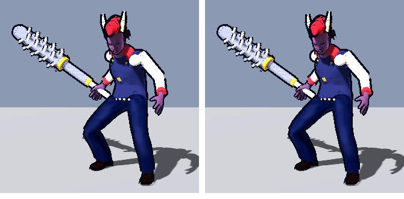

# 版104：軽量化② ボスの影と輪郭線もまとめる（2026-10-21）

版103 の続き（キャラと同じ CharacterView.build_proxies をボスにも使う）。

## したこと
- `scripts/boss/boss_model.gd`：いつも出ている服・小物（目・服・くつ・角などの小物）の影と輪郭線を、まとめた形で描く。
  - **まとめない物**：出し入れする小物（バット・覚醒の小物）と、肌の材質を使う形。
    肌の材質は、攻撃の時の長い手（SweepHand）と同じ材質で、輪郭線の太さが長い手の側で決まっている。まとめると、顔や指の線の太さが変わって見えた（写真で確かめて、外した）。
  - 材質は写さない（ボスだけの材質。当たった時に光らせる set_flash が、そのまま効く）。
- `character_view.gd` の `build_proxies` に、まとめない形（exclude）と、材質を写さないやり方（dup_materials=false）を足した。

## 結果（ボスだけ・同じ姿勢・画質 high・llvmpipe）
| | 前 | 後 |
|---|---|---|
| 描画の回数（影あり） | 34 回 | **22 回** |
| 描画の回数（影なし） | 17 回 | 13 回 |
| 画素の差 | — | 影なし 0 画素・影あり 21 画素（54万のうち） |

## テスト
- test_v103 にボスの確かめを足した（9）：服・小物をまとめる／バット・覚醒の小物・肌の形はまとめない／光らせる仕組みが効く。
- 全テスト：Godot 80本・Node 66件 合格。
