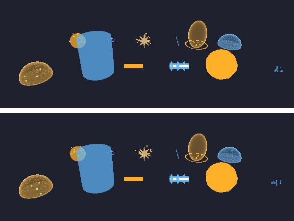
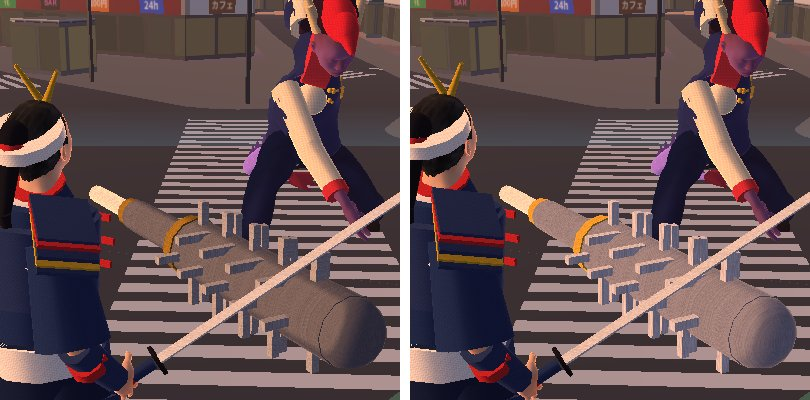

# 版105：軽量化③ 技・当たりの見た目で1コマだけ長くなるのを減らす（2026-10-21）

ユーザーの依頼（02:34）の③。実機（版102・iPhone・画質 high）で、戦いの「しょりさいだい」が **80 ms**（その1秒でいちばん長かった処理）・おそいコマ 1〜2回/秒 だった。

## 原因（根拠つき）
1. **長いコマ＝技・当たりの見た目を作ったコマ**（`tools/perf_spikes.gd`：画面なし・1コマ＝1/60秒・60秒の戦い×2）：
   まん中の4倍以上長いコマ 26 回のうち 22 回が、技の見た目（SkillFx_spark・ripple・aura・blast・orb、必殺技の UltFx_charge など）や投げるバット（部品 44 こ）を作ったコマだった。
2. **重いのは「新しい材質」**（PC での1回の時間）：
   | した事 | 時間 |
   |---|---|
   | 新しい材質を作って、はじめて使う | **0.35〜0.77 ms** |
   | 同じ材質を、もう一度使う | 0.025 ms |
   | 粒（CPUParticles）を作る（材質つき） | 0.74〜1.27 ms |
   | 形（球・輪）を作る | 小さい（材質ほどではない） |
   火花1つで材質3つ（星・白い光・粒）、当たり1回で 4〜6 こ作っていた。4人が技を出すと、その1コマに 10 こ以上 → PC で 5〜13 ms。スマホのブラウザではその数倍（＝しょりさいだい 80 ms と合う）。
3. 投げるバット：はじめて投げた時に、部品 44 こを作っていた（飛んでいる間も 44 回描いていた）。

## したこと
- `scripts/fx/fx_pool.gd`（新）：見た目の材質を使いまわす。見た目が消える時（queue_free）に返してもらい、同じ種類（色・光・すけ方・板の向き）の次の見た目で使う。付けかえでは返さない。1種類 24 こまで。
- `scripts/fx/skill_fx.gd`：
  - 材質（`_mat`・膜の `dome_material`）を使いまわす。使っている間に変わる所（すけ具合・光の強さ・膜の消え具合 fade・脈 pulse）は、取り出す時に元にもどす。
  - 形（球・輪・筒・星・粒の板）を、同じ大きさなら使いまわす。色は形でなく、その見た目だけの材質（material_override）に持たせる。ビーム・斬撃の筒は、長さ1の筒を長さの分のばす（形は同じ）。
- `scripts/fx/ultimate_fx.gd`：必殺技の見た目も、材質と形（輪・三日月）を使いまわす。
- `scripts/prototype/battle_attack_fx.gd`：投げるバットを、戦いの始まりに作っておき（隠す）、部品 44 こを1つの形にまとめる（手に持っているバットと同じまとめ方）。

## 結果（画面なし・PC・60秒の戦い×2）
| | 前 | 後 |
|---|---|---|
| 見た目を作った時の長いコマ（まん中の4倍以上） | 22 回 | **5〜7 回**（多くは、戦いのはじめに、はじめての色の見た目を出した時） |
| 長い方から 1% のコマ | 4.1〜4.3 ms | **2.9〜3.4 ms** |
| 見た目を作る時間（火花・輪・膜など、2回目から） | 0.8〜3.0 ms | **0.2〜0.4 ms** |
| 投げるバットの描画 | 44 回 | 1 回（＋影） |

（新しい物を作っていないのに長いコマも、少しある：この作業機のゆれと見られ、回ごとに場所がちがう）

見た目：技の見た目は同じ（3回使いまわしたあとで撮っても同じ）。投げるバットは、手に持っているバットと同じ描き方になり、ほんの少しなめらかに見える。

## 道具
- `tools/perf_spikes.gd`：長いコマと、そのコマでできたノード。
- `tools/shot_fx.gd`・`tools/shot_bat.gd`：技の見た目・投げるバットの写真。

## テスト
- test_v105（12）：材質を返す・次で使う・すけ具合はもどる・色ちがいは別・使っている間は貸さない・付けかえでは返さない・膜・aura・形の使いまわし・ビームの長さ・必殺技・バット。
- 全テスト：Godot 81本・Node 66件 合格。

## 残り
- はじめての色の見た目を出す時（戦いのはじめ）の、材質を作る時間と、スマホの絵の準備（シェーダー作り）。必要なら、戦いの始まりに先に作る。
- 実機での効き目は未計測（`?perf=1` の「しょりさいだい」「おそい」で見られる）。
