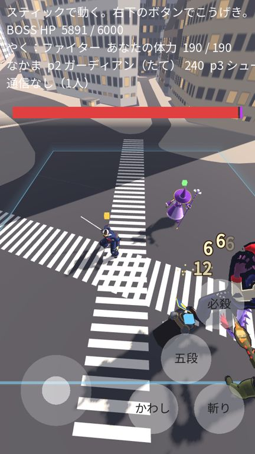
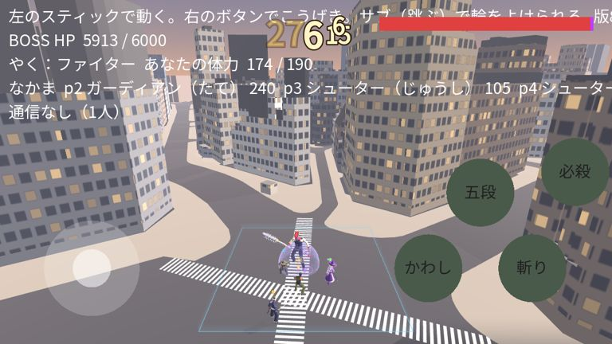
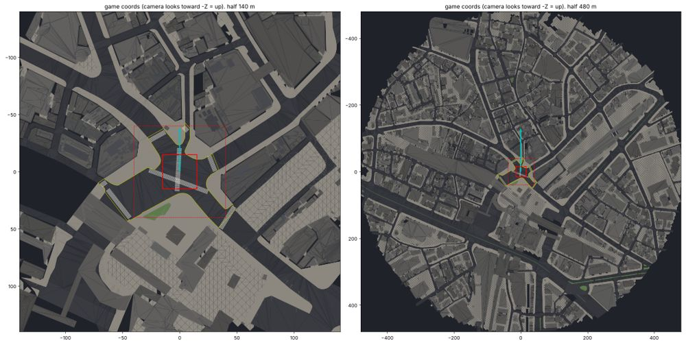

# 版88：戦いのマップを、渋谷のスクランブル交差点に（2026-10-20）

ユーザーの指示：「北千住→渋谷」「中心はスクランブル交差点（平ら）。戦いは交差点の中」「まわりの建物は PLATEAU の本物の形で、背景に」「今のマップのまん中に交差点のまん中を合わせる」「今のマップの領域の外へは行けないように」「北千住になっている所を渋谷に」。
データ：ユーザーが G空間情報センターから取ってきた PLATEAU 渋谷区（2025年度）の CityGML（建物・道路 ×4区画、地形 533935）。

 

## 1. できたこと
- **戦いのマップ**：前の「40m四方の緑の板」をやめて、**渋谷のスクランブル交差点**にした（`scripts/stage/map_loader.gd`・`data/maps.json`）。古い板は作らない（マップが読めない時だけの予備）。
- **交差点のまん中＝ゲームのまん中 (0,0,0)**：交差点の車道（車道交差部）の重心のあたり（北緯 35.659467・東経 139.700472）。地面の高さ（約15.2m）を 0 にした。
- **向き**：カメラの奥（画面の上）が、交差点の北西（QFRONT・センター街の方）。ハチ公前の広場の側から見る形（`heading_deg: -45`）。
- **まわり（背景）**：PLATEAU の本物の形で、交差点から半径 **480m** まで。
  - 建物：230m までは屋根の形まで（LOD2）、その外は箱（LOD1）。110m までは屋上の設備も。合わせて約1,200棟。
  - 道路：車道・交差部・歩道・島（LOD3。高さは本物。坂もそのまま）。
  - 地形：道路と建物がない所（駅前の広場など）。
  - **位置の確かめ**：いちばん高いビル（渋谷スクランブルスクエア）が、緯度・経度から計算した場所に、本物の高さ（約228m）で立っていることをテストで確認。
- **色だけで、写真の模様は使わない**（看板・広告・お店のロゴを出さないため）。窓は計算で描く（`shaders/city_buildings.gdshader`：階と列ごとのガラス・夕方の明かり）。
- **横断歩道**：PLATEAU にはないので、道路の形から作った。交差点に入る道の入り口ごと（6か所）と、ななめの横断歩道（2本）。本物の位置と、少しちがうことがある。
- **平ら**：交差点の中（まん中から ±40m）を平らにして、外へ 25m かけて本物の高さへもどす。戦いの場所（±15m）の床のずれは 3cm 以下（歩道の段差の分）。キャラの足は床の高さに合う。
- **外へは行けない**：動ける範囲は今までどおり ±15m（`bounds`）。念のため、毎コマ、自分とAIの味方を範囲の中にもどす処理も足した（ボスにつかまれている間はのぞく）。さかいには、床の光る線と、うすい壁を出した。
- **空・霧・光**：夕方の空のグラデーション、遠くがかすむ霧、夕方の日の光（`data/maps.json`）。
- **画質**：低（iPhone）は遠くの建物を 330m までで消す・建物の影なし。高は 480m まで・近い建物の影あり。
- **「きたせんじゅ」→「しぶや」**：ロビーのステージ選び（`data/game_flow.json` の stages）。設計の文書も直した。

## 2. 作り方（`tools/plateau_to_glb.py`）
1. CityGML を少しずつ読む（建物：LOD2 の壁・屋根・設備／LOD1。道路：LOD3 の面。地形：三角形）。読んだ結果は作業用フォルダに保存（2回目から速い）。
2. 緯度・経度・高さ → ゲームの座標（1=1m）。まん中・向き・半径は `data/maps.json` の build。
3. 交差点を平らに・遠くを箱に・色を付ける・道路と地形の点をまとめる（ファイルを小さく）。
4. `assets/maps/shibuya/shibuya.glb` に書く（地形・道路・横断歩道・近い建物・遠い建物の5つ）。上から見た図も作れる。
- 実行：`python3 tools/plateau_to_glb.py --src <CityGML のフォルダ> --cache <作業用> --preview <図.png>`（mapbox_earcut・shapely・scipy・lxml が必要）
- 元の CityGML（約1.3GB）は、リポジトリに入れていない。

## 3. 数
- 三角形：約11万（地形 1.9万・道路 4.1万・横断歩道 400・近い建物 3.2万・遠い建物 2.0万）
- .glb：4.5MB（Godot に取りこむと 2.6MB）。書き出し（index.pck）は 18.2MB → 20.8MB。全体で約60MB（目標 100MB 未満）

## 4. テスト
- `tests/test_v88.gd`（新規・25項目）：設定・出典（設定と LICENSES.md）・ステージの名前／古い板がない・マップは1つ・5つの部品／戦いの場所の床は平らで、すきまがない（961点）・中に建物がない・横断歩道がある／スクランブルスクエアの位置と高さ・いちばん高い建物／8つの方向すべてに建物・480m先まで／外へ動き続けても ±15m で止まる・AIも外に出られない・足もとの床の高さ／画質（低・高）・空と霧・窓のシェーダー・さかい／三角形の数・ファイルの大きさ
- `tests/test_game_flow.gd`・`tests/test_v81.gd`：ステージの名前を「しぶや」に
- 写真：`tools/shot_map.gd`（sky・street・top・battle）、`tools/shot_battle.gd`
- 全テスト：Godot 68本・Node 66件、全部合格

## 5. 未確認
- **iPhone 実機での重さ**（三角形 約11万が増えた。画質「低」で遠くを早めに消している）。重ければ、半径・LOD2 の範囲をせまくする（`data/maps.json` の数値と、道具の作り直しで変えられる）。
- 横断歩道の本物の位置（道路の形から作ったので、少しちがうことがある）。
- ロビー・ガチャの背景は、まだ前の街（計算で作ったもの）のまま。渋谷にするかは、まだ決めていない。
- ブラウザ（WebGL）での見た目は、作業場所の OpenGL の写真で確かめた（同じ描き方）。実機では未確認。
