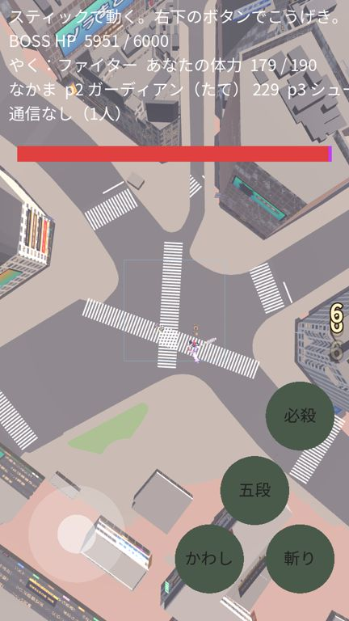
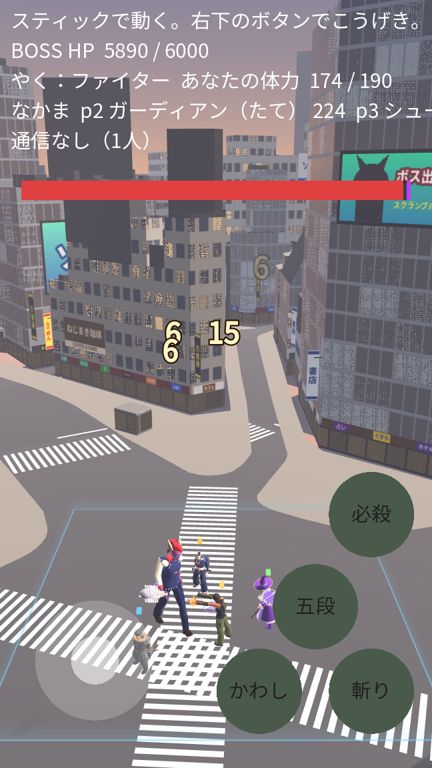
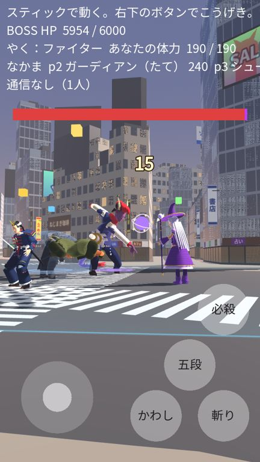
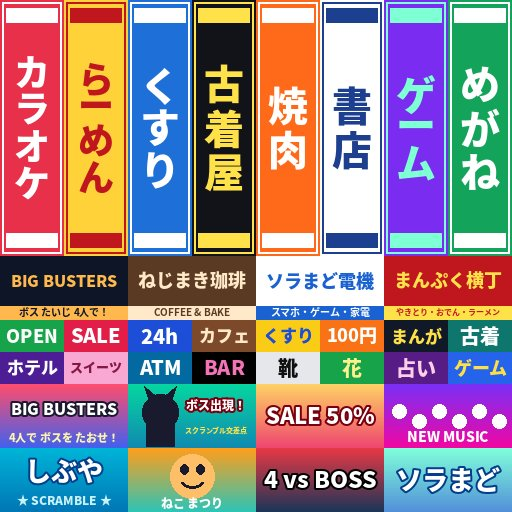

# 版89：渋谷の背景を、参考の写真に近づける（2026-10-20）

ユーザーの依頼（18:07「ゲーム画面の背景・時間帯・カメラワーク・HP UI修正プロンプト」と、渋谷のスクランブル交差点の写真）のうち、**1. 背景**の部分。
順番はユーザーが決めた：版89 背景 → 版90 夕方・覚醒で夜 → 版91 カメラ → 版92 HP の表示。全部できたら、1回公開して URL を送る。

## したこと

### 横断歩道（写真に合わせる）
- 白線の幅 45cm・すき間 45cm（日本の決まりと同じ）。
- 横断歩道の幅（白線の長さ）を 4m → **6m**（ななめ 5.5m）。写真の、太くて長い白線に近づけた。
- **車の止まる線**（45cm）を、交差点に入ってくる側の半分だけに（日本は左側を走る）。横断歩道の 2m 手前。
- 白線の四角の向きを、上から見て必ず表になるようにした（向きで消えることがない）。

### 建物の材質（3種類＋屋根・設備）
写真の渋谷は「白っぽいタイルの壁に四角い窓」「黒っぽい・青っぽいガラスのビル」「横長の窓の帯と金属のパネル」が多い。
建物ごとに、高さで割合を変えてえらぶ（data/maps.json の build.materials）。

| 材質 | 見た目 | 高い（40m〜） | 中（15〜40m） | 低い |
|---|---|---|---|---|
| タイルの壁と窓 | 白・灰・ベージュの壁に四角い窓 | 10% | 45% | 70% |
| ガラス | 空の色がうつる・細い金属のわく・明かりのついた階 | 65% | 25% | 0% |
| 横長の窓とパネル | 階ごとの窓の帯・銀色のパネル | 25% | 30% | 30% |

- どの建物も、**1階は店のガラス**（中の明かり）。
- 遠くの窓は、細かすぎてちらつかないように、平均の色へなめらかに変える（画面での大きさを見て）。
- 屋上の設備は金属に。

### 看板・大画面（自作）
- 絵：`assets/maps/shibuya/signs.png`（512×512・84KB）。`tools/make_signs.py` が作る。**店名・ロゴは全部自作**（本物のお店・ブランドに似せない。ユーザーが「自作の店名・ロゴの看板」をえらんだ）。
  - たて長の看板 8（カラオケ・らーめん・くすり・古着屋・焼肉・書店・ゲーム・めがね）
  - 横長の看板 4（BIG BUSTERS・ねじまき珈琲・ソラまど電機・まんぷく横丁）
  - 店の前の帯 16（OPEN・SALE・24h・カフェ…）
  - 大画面の絵 8（このゲームの宣伝・ボス出現・SALE・しぶや…）
- 置き方（`tools/plateau_to_glb.py` の build_signs。数は data/maps.json の build.signs）：交差点のほうを向いた壁（140m の中）だけに。
  - 大画面 6：大きくて交差点からよく見える壁から（1つの建物に1つ）。6秒ごとに 0.6 秒かけて次の絵へ（点めつしない）。
  - 1階の店の帯 310・角から横に出るたて長の看板 112（両面）・壁の横長の看板 164（センター街の入り口のように重ねる）・屋上の看板 8。
- 中から光る看板として、少し光る（夕方は弱く、夜は強く：版90）。

### 色
- 道路を少し明るい灰色、歩道を灰色に（前はベージュが強かった）。駅前の広場（ハチ公の広場のあたり）は赤茶色のタイル。

  

看板の絵（自作）：

## 変えたファイル
- `tools/make_signs.py`（新）・`assets/maps/shibuya/signs.png`（新）
- `tools/plateau_to_glb.py`：建物の材質と UV・看板と大画面（build_signs）・止まる線・白線の向き・TEXCOORD_0 を書く
- `assets/maps/shibuya/shibuya.glb`：作り直し（5.5MB。部品に Signs・Screens が増えた）
- `shaders/city_buildings.gdshader`（材質3種類・1階の店・遠くのちらつき止め・night）、`shaders/city_signs.gdshader`（新）、`shaders/city_screens.gdshader`（新）
- `scripts/stage/map_loader.gd`：看板・大画面の材質、ガラスにうつす空の色
- `data/maps.json`：build.materials・build.signs・build.crosswalk・signs・windows（夜の数値）
- `assets/LICENSES.md`：看板の絵（自作・フォント）
- `tests/test_v89.gd`（新・25項目）

## テスト
- test_v89（25）：設定・絵の大きさ・自作の記録・部品とシェーダー・材質3種類・UV・看板の場所（戦いの場所の外・交差点を向く）・大画面の数と形・白線の幅 45cm と長さ・止まる線・night・重さ。
- 全テスト：Godot 69本・Node 66件 合格。

## 未確認
- iPhone・Android の実機での重さ（看板の三角形 2,748・絵 1まい増えた）。
- 写真との近さは、人の目で見てもらう必要がある。今の戦いのカメラでは、背景がまだあまり見えない（版91 でカメラを直す）。
- 明るさ・空の色は、版90（夕方と夜）で合わせる。
