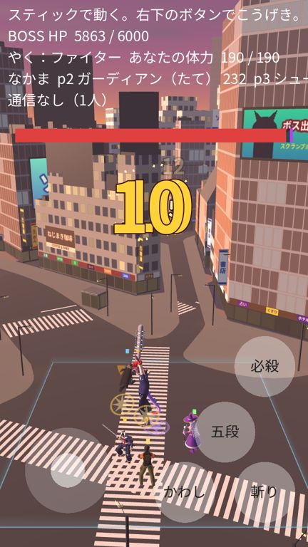
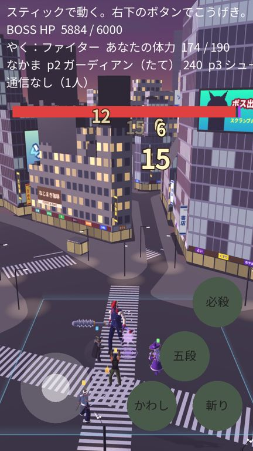
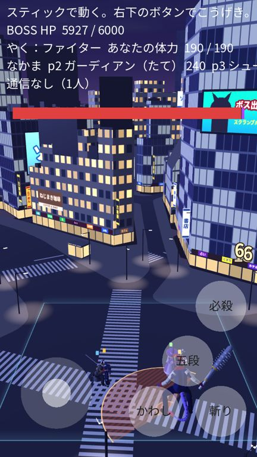
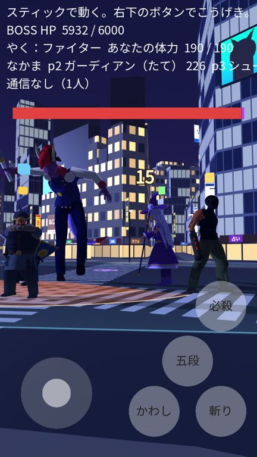

# 版90：ふだんは夕方・覚醒で夜（2026-10-20）

ユーザーの依頼（18:07）の **2. 時間帯と覚醒状態による背景の変化**。

## 「覚醒」について
このゲームの戦いの中の「覚醒」は、**ボスの第2形態**（体力が0になって倒れ、「覚醒！」で起き上がる。曲も覚醒の曲になる）だけ。
キャラの「覚醒能力」は編成の画面にある仮の項目で、まだ戦いには使っていない。
そこで、**ボスの覚醒（第2形態）の間を夜**にした（曲の合図 awake と同じ時）。
あとでキャラの覚醒を作ったときも、`stick_prototype.night_wanted()` を変えれば同じしくみで夜にできる。

## したこと
- 時間帯のしくみ `scripts/stage/time_of_day.gd`（新）：夕方と夜の数値（data/maps.json の time_of_day）の間を、t（0 夕方〜1 夜）でなめらかに混ぜる。
  - 夜へ 1.6 秒（覚醒がすぐ分かる）、夕方へ 3.0 秒。ゆっくり始まってゆっくり終わる混ぜ方なので、ちらつかない（1/60秒で変わる量は最大 1.6%）。
  - 勝った・負けた・ボスを倒した（覚醒が終わった）ら夕方へもどる。次の戦いは夕方から。
- 空 `shaders/city_sky.gdshader`（新）：地平線 → 中 → 上の3色、夕日のまわりの光、うすい雲。星は入れない（細かい点はカメラが動くとちらつくため）。
  - 夕方：地平線オレンジ・中は赤むらさき・上は暗めの青。
  - 夜：地平線は青むらさき（街の明かり）・上は紺。真っ黒にしない（建物の形が空に対して見える）。
- 光：夕日は**南西（画面の左）から低く**（実際の秋の渋谷の夕日の方角）。交差点を向いた右がわのビル（QFRONT のあたり）に夕日が当たり、左がわは影になる。向きは夜も変えない（影が動かない）。夜は青白い月の光（弱く）。
- まわりの明るさ・霧も、夕方と夜で変える。
- 夜に光るもの：窓（明かりのつく窓 24% → 62%）・1階の店・看板・大画面・**街灯（新）**。
- **街灯**（`tools/plateau_to_glb.py` の build_lamps）：交差点の歩道の角に沿って 23 本（7.5m の柱・うで・光る頭）。下の地面に光の輪（本物の光は使わず、光を足す板＝軽い）。
- 夜は横断歩道の白線を少し光らせる（暗やみにうもれない）。
- 変えないもの：建物・道路・白線の形と場所、光の向き、カメラ。

左から：夕方・切りかえの途中・夜・夜（人の目の高さ）

   

## ほかに直したこと
- 建物の窓が、ところどころ「ざらざら」に見えていた（版88から）。原因：建物ごとの乱数（UV）のわずかな補間のずれで、乱数が点ごとに変わっていた。乱数を整数にしてから使うように直した。

## 変えたファイル
- `scripts/stage/time_of_day.gd`（新）・`shaders/city_sky.gdshader`（新）・`shaders/city_lamps.gdshader`（新）・`shaders/city_light_pool.gdshader`（新）
- `scripts/stage/map_loader.gd`：街灯の材質・night を持つ材質の一覧・横断歩道の光（apply_environment・apply_light は time_of_day.gd へ）
- `scripts/prototype/stick_prototype.gd`：時間帯をつなぐ（night_wanted・_time_of_day_update・始まりは夕方）
- `shaders/city_buildings.gdshader`：乱数のざらざらを直した
- `tools/plateau_to_glb.py`：街灯と光の輪（Lamps・LightPools）
- `assets/maps/shibuya/shibuya.glb`：作り直し（5.6MB）
- `data/maps.json`：time_of_day・lamps・build.lamps（sky・ambient・fog・light は time_of_day へ）
- `tools/shot_map.gd`：時間帯（evening / night / 途中の割合）を選んで写真を撮れる
- `tests/test_v90.gd`（新・32項目）

## テスト
- test_v90（32）：空の色（夕方3色・夜は暗いが真っ黒ではない）・始まりは夕方・覚醒で夜へ（途中・1フレームの変化・だんだん暗く・なりきる）・夜に光るもの・白線・街灯・形と光の向きとカメラは変わらない・倒したら夕方へ・次の戦いは夕方から。
- 全テスト：Godot 70本・Node 66件 合格。

## 未確認
- 実機（iPhone・Android）での色の見え方・重さ（空のシェーダーの雲の計算・光の輪）。
- 「プレイヤーの覚醒」が、ボスの覚醒（第2形態）のことで合っているか（ユーザーに確認したい）。
