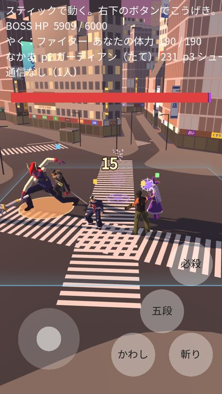
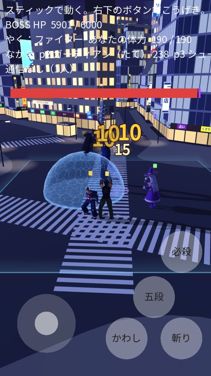
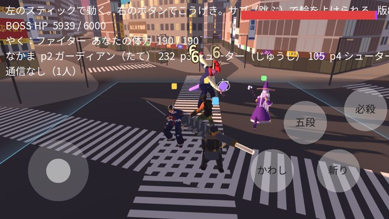

# 版91：戦いのカメラ（高さ・角度・遠近）を自然に（2026-10-20）

ユーザーの依頼（18:07）の **3. カメラワーク・視点の調整**。

## 前の問題（版90まで）
- たて画面の画角を「横 78°」で決めていたので、**たての画角が 110° 近く**になっていた（とても広角）。
  画面の下の白線がとても太く・長く、上の建物は大きくかたむいて見えた（はしの引きのばし 3.1 倍）。
- 見下ろす角度が 50°（たて）・37°（横）と急で、交差点の先の建物・看板・空がほとんど見えなかった。
- 強い攻撃の画面のゆれが、毎フレームでたらめ（乱数）で、背景がガタガタはねていた。強い攻撃のカメラの寄りは、1フレームで一気に寄っていた。

## したこと（`scripts/prototype/camera_rig.gd` 新・数値は data/prototype_stick.json の camera_rig）
- 画角は、たて・横どちらも「たて」で決める：たて画面 **70°**、横画面 55°。はしの引きのばしは 1.5 倍に（前の半分）。
- 見下ろす角度：たて画面 **22°**、横画面 21°。画面の上は地平線より上まで見える（センター街の入り口・QFRONT のあたりの建物・看板・大画面、すき間から空）。写真の「交差点の向こうを見る」見え方に近づけた。
- 見る点は床から 2m（たて）・1.8m（横）。キャラが画面のまん中に来て、上に背景が広がる。
- 画面の形（iPhone の 9:19.5・9:16・横）から、カメラの距離を計算して、見える横の広さをそろえる（たて 22〜24m・横 36m）。前と、キャラの大きさはほぼ同じ。
- 自分についていく動きを「ばね」に（なめらかに動き始めて止まる）。急に遠くへ動いても、1フレームで 0.6m 以下。
- 画面のゆれ：2つの波を重ねた、なめらかなゆれ（だんだん小さく）。カメラの向きは変えず、位置だけ動かすので、遠くの背景ははねない。
- 強い攻撃のカメラの寄りも、なめらかに寄ってから戻る（1フレームで距離の 1.7% まで）。
- カメラの手前に立つ街灯は、戦いの場所の前をふさぐので立てない（23本 → 12本）。
- 夕方・夜を変えても、カメラは同じ（版90）。

たて（夕方・夜）と横：

 

（上の文字の行・ボスの体力の帯は、版92 で新しい HP の表示に変える）

## 変えたファイル
- `scripts/prototype/camera_rig.gd`（新）・`scripts/prototype/battle_hud.gd`（apply_orientation：画面の形が変わったらカメラを決めなおす）
- `scripts/prototype/stick_prototype.gd`（camera_update：見る点の高さ・ばね・なめらかなゆれと寄り）
- `data/prototype_stick.json`（camera_rig）・`data/maps.json`（街灯を手前に立てない）・`tools/plateau_to_glb.py`・`assets/maps/shibuya/shibuya.glb`
- `tests/test_v91.gd`（新・32項目）、`tests/test_stick_prototype.gd`・`tests/test_v79.gd`（新しいカメラに合わせて直した）

## テスト
- test_v91（32）：4つの画面の形で、画角・角度・地平線より上まで見える・横の広さ・距離／はしの引きのばし／戦いの場所のまん中・奥・ボスが見える／向き／ついていく・ゆれ・寄りが跳ねない。
- 全テスト：Godot 71本・Node 66件 合格。

## 未確認
- 実機（iPhone・Android）での見え方・操作のしやすさ（カメラが前より低いので、奥行きの感じ方が変わる）。
- 戦いの場所の手前のはしは、たて画面ではボタンの下にかくれる（前と同じ）。
