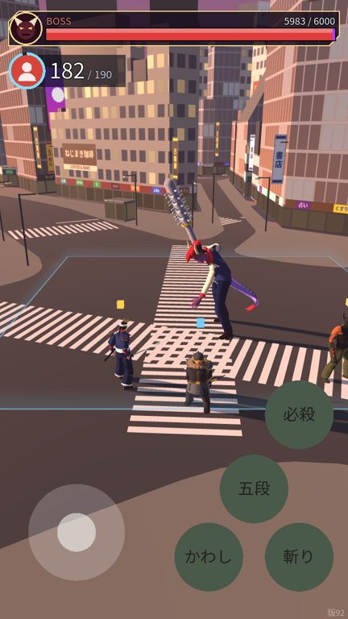
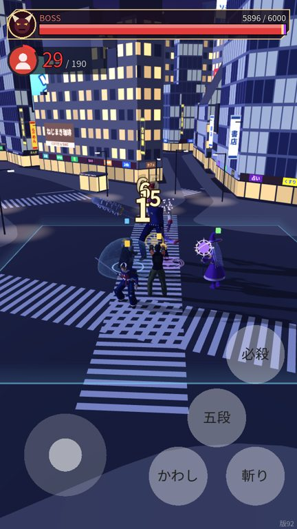
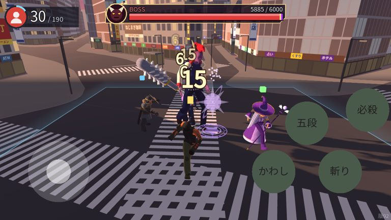
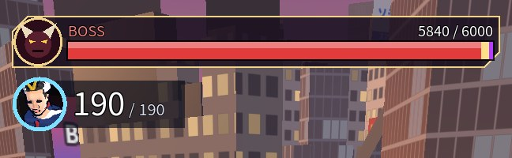

# 版92：上の文字の行をやめて、体力の表示を新しく（2026-10-20）

ユーザーの依頼（18:07）の **4. 右上の不要な表示の削除・5. 自分の HP・6. ボスの HP メーター・7. カメラ・背景・UI の連携**。
「右上の不要な表示」は、ユーザーに確認して「上の文字の行」と決めた。

## やめたもの（上の文字の行）
- 説明（スティックで動く…）と版の数字・BOSS HP の文字・やく／あなたの体力・なかまの体力・通信の状態。
- 前のボスの体力の帯（細い赤い帯）も、新しいメーターに置きかえた。
- 版の数字（公開した版の確認用）だけは、右下に小さく・うすく残した。

## 新しい体力の表示（`scripts/prototype/battle_hp_hud.gd` 新・数値は data/prototype_stick.json の hud）
画面に固定（カメラが動いても・ゆれても・寄っても、場所と大きさは同じ）。

### ボス（画面の上）
- 自作のボスのアイコン（角と光る目の顔。覚醒すると目がむらさきに光る）＋体力のメーター＋数字「いま / 最大」。
- メーターは本当の体力と同じ割合で、すぐ短くなる。減った分は黄色の帯で少し残ってから縮む（どれだけ減ったか分かる）。
- 覚醒（第2形態）は、むらさきのメーターと「覚醒 BOSS」。満タンにもどる時は、帯もすぐ合わせる。第1形態の間は、右はしに「第2形態がある」小さな印（前と同じ）。
- 角を切った濃い下じき・金色のふち（自分の表示とはっきり分かれるデザイン）。

### 自分（ボスの下の左）
- 丸いアイコン：自分のキャラの顔の絵（ロビーと同じ、3Dから作る絵）。作れない所では、役の色の丸と人の形。
- アイコンの横に体力の数字（大きく）と「/ 最大」（小さく）。数字は本当の体力（切り上げ）。
- **体力が 30 未満で赤**（30 ちょうどはふつうの白、29 で赤）。数字と色がずれないように、表示する整数で決める。
- アイコンのまわりの輪は体力の割合（低い時は赤、当たった直後は白く光る）。体力が変わると数字が少しはねる。倒れたら「ダウン」。

### 読みやすさ・重ならないこと
- 字は黒いふちどり（5px）、下じきは濃い色：夕方・夜のどちらの背景でも読める。
- たて画面：ボスは上はし、自分はその下の左（画面の上から 14% まで）。横画面：ボスは上のまん中、自分は左上。
- スティック・ボタンと重ならない（iPhone のたて・横、9:16、16:9 で確かめた）。怒りの文字・勝ち負けの文字は、体力の表示の下に出す。

たて（夕方）・たて（夜・体力 29 で赤）・横（体力 30 は白）：

 

顔の絵が入った時（画面の流れから）：

## 変えたファイル
- `scripts/prototype/battle_hp_hud.gd`（新）
- `scripts/prototype/battle_hud.gd`：上の文字の行と前のボスの帯をやめて、新しい表示を描く。版の数字は右下。怒り・勝ち負けの文字の場所
- `scripts/prototype/stick_prototype.gd`：hp_hud・hud_portrait・hud_role_color。戦いの始まりで表示をもどす
- `scripts/flow/game_flow.gd`：戦いを始める時に、自分のキャラの顔の絵を戦いに渡す
- `data/prototype_stick.json`：hud・build_id 92
- `tools/shot_map.gd`：SHOT_HP（体力を決めて撮る）・画面の字も描きなおして撮る
- `tests/test_v92.gd`（新・40項目）

## テスト
- test_v92（40）：文字の行がない／30 は白・29 は赤・29.4 は 30 で白／ダメージ・回復ですぐ変わる・ダウン／ボスのメーターと数字・黄色の帯・覚醒の色とラベル・満タンの時／4つの画面の形で、画面の中・重ならない・スティックとボタンに重ならない・上 14% まで／カメラが動いても同じ／ふちどり・濃い下じき／顔の絵を渡す。
- 全テスト：Godot 72本・Node 66件 合格。

## 気をつけてほしいこと
- **なかまの体力と、通信の状態の文字も、上の文字の行といっしょに消えた**（ユーザーの「上の文字の行」に入っていたため）。通信で遊ぶ時に、つながりが切れた・つなぎ直し中の文字も出なくなった。いるようなら、別の形で出す。

## 未確認
- 実機（iPhone・Android）での字の大きさ・読みやすさ・顔の絵の出方。
