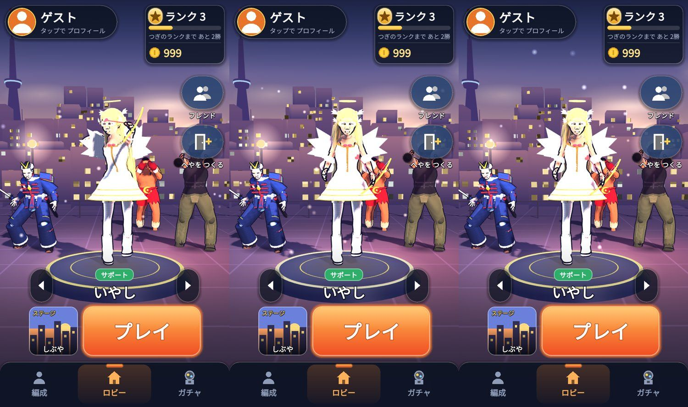

# 版93：ロビーのキャラを、それぞれの A攻撃の動きに（2026-10-20）

ユーザーの依頼（21:23「ロビーキャラのモーション変更とコード全体の調査・軽量化」）の 1 つめ。3回に分けた（ユーザー決定）：
版93 ロビーのモーション → 版94 重さの調査と計測 → 版95〜 原因ごとに直す。
見せ方は、ユーザーが「A攻撃を休まずくり返す」をえらんだ。

## 調べたこと
- ロビーの3Dのキャラ：`scripts/flow/lobby_stage.gd`（`_make_unit` でキャラの形 `CharacterView` を作り、`play_action("idle")`。編成が変わっても、同じキャラは作り直さず場所だけ動かす）。
- 戦いの A攻撃：右下のいちばん大きいボタン＝技の id `normal`。数値は `data/char_actions.json`（8人。label が "A"）と、剣士は `data/actions.json`（label は「斬り」）。
  技の動きは steps の `anim`（キャラの animations の名前）と `speed` を、戦いでは `CharacterView.play_step` で流している。
  当たり・音・光・待ち時間は、技の実行（`player_actions.gd`・`stick_prototype.gd`）が別に出すので、`play_step` だけなら動きだけになる。
- 9人とも、自分専用の A攻撃の動きがある。動きは1回で終わる（ループなし）・その場で動く（腰の骨は横に動かない。ルートモーションなし）。

## 対応表（9人）
| キャラ | A攻撃 | 動き | 速さ | 1回の長さ |
|---|---|---|---|---|
| hero_swordsman（剣士） | 単純斬り（斬り） | Sword_Attack | 3.0 | 約0.51秒 |
| sprinter | 高速ジャブ | Sprinter_A | 1.0 | 0.25秒 |
| brawler | ジャブ | Brawler_A | 1.0 | 0.30秒 |
| gunner | ダブルショット | Gunner_A | 1.0 | 0.30秒 |
| bomber | プレゼント投げ | Bomber_A | 1.0 | 0.60秒 |
| mage | マジックショット | Mage_A | 1.0 | 0.50秒 |
| guardian | 棍棒 | Guardian_A | 1.0 | 0.50秒 |
| summoner | ぬいぐるみ投げ | Toy_A | 1.0 | 0.40秒 |
| healer | ハートの矢 | Angel_A | 1.0 | 0.40秒 |

未対応のキャラ：なし（動きがないキャラが増えた時は、今までどおり待ちの動きにして `unsupported` に記録する）。

## したこと（`scripts/flow/lobby_stage.gd` だけ）
- `attack_for(id)`：戦いと同じ設定（`Actions.config_for(id)` の `normal` の最初の steps）から、動きの名前と速さを読む（キャラごとに1回だけ読んで覚える）。名前は設定から読むので、決め打ちしていない。キャラを足しても、char_actions.json に書けばそのまま使える。
- `play_attack(view, id)`：戦いと同じ `play_step` で、動きだけを最初から流す。
- 動きが終わったら（`animation_finished`）、すぐ最初から（休まずくり返す）。つなぐのは、キャラの形を作った時の1回だけ（二重にならない）。勝ちポーズ・待ちの動きの時は、くり返さない。
- メインに来たキャラの勝ちポーズ（版81b）は、そのまま残した。勝ちポーズのあと、A攻撃へ（前は待ちの動きへ）。
- 4人の動きは、出した時に少しずつずらす（前の待ちの動きと同じ。そろわない）。
- ロビー専用の新しいしくみは作っていない（戦いの設定と再生の関数を、そのまま使う）。

## テスト
- test_v93（25）：9人の対応（戦いと同じ動き・速さ・全員ちがう）／出すと A攻撃（9人）／くり返し（4秒で13回・止まらない・同じ動き）／入れかえ（勝ちポーズ→A攻撃・ほかのキャラの動きにならない）／作り直さない・つなぎは1つ／場所は動かない・腰の位置は最初と最後で同じ／戦いの処理を呼ばない／動きがないキャラは待ちの動き／ロビーに入りなおしても正しい。
- test_v81 の1項目（勝ちポーズのあと「待ちの動き」→「A攻撃」）を、新しい動きに合わせて直した。
- 全テスト：Godot 73本・Node 66件 合格。
- 画面のない所では骨の形が更新されないので、テストは動きのデータで調べた。見た目は写真（上）で確かめた。

## 未確認
- 実機（iPhone・Android）での見え方。動きが短い（0.25〜0.6秒）ので、休まずくり返すと速く見えるかもしれない（待ちを入れる形にもすぐ変えられる）。
