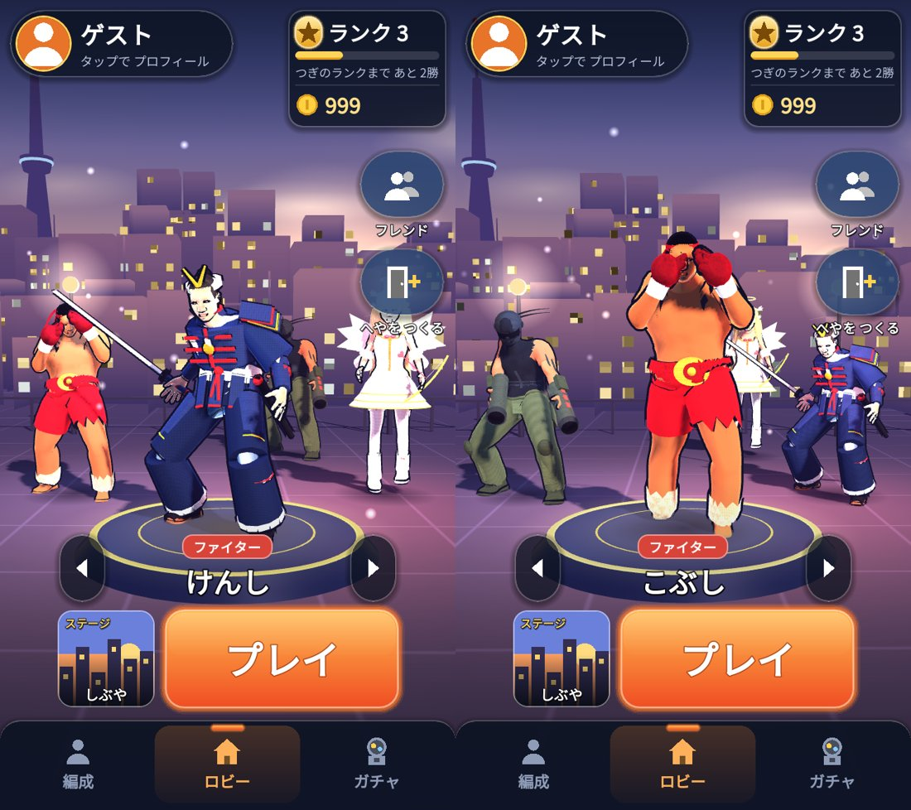

# 版94：ロビーのキャラは静止、前に来た時だけ A攻撃を1回（2026-10-20）

ユーザーの指示（22:10）：版93 の「後ろも前も A攻撃を休まずくり返す」は動きすぎ。
**後ろに入れた時は静止。前に持ってこられた時だけ A攻撃を1回して、静止にもどる。後ろへ行ったら静止。**

## したこと（`scripts/flow/lobby_stage.gd`）
- 静止（`set_still`）：待ちの動きの最初の形で、再生係を止める（体が動かない）。止めている間は動きの計算をしないので、ロビーが少し軽くなる。
- 前（まんなか）に持ってこられた人：着いた時に、そのキャラの A攻撃（版93 と同じ動き・速さ）を1回 → 終わったら静止（くり返さない）。前の「勝ちポーズ」は、この A攻撃に置きかえた。
- 後ろへ行った人：すぐ静止（攻撃の途中でも）。
- はじめてロビーを出した時は、だれも攻撃しない（全員静止）。
- 動きのデータ・再生の関数は、版93 と同じ（戦いと同じ設定・`play_step`。当たり・音・光は出さない）。

左：前に来た直後（まだ動いている）、右：落ちついた後（全員静止）

## あとに回したこと（ユーザーの指示）
同じ指示の中の、次の2つは「またにする」（Firebase の設定を今はさわれないため）。NOTES の「決まっていること」に書いた。
- 同じキャラを2体選べない：ひとりで遊ぶ時の編成は、もともと同じキャラを2人入れられない（`Roster.assign` が入れかえる）。通信の部屋の中で、ほかの人と同じキャラにならないようにするのは、まだ。
- 通信の時の AI 補充（2人なら AI 2人、3人なら AI 1人）。

## テスト
- test_v93（25）を新しい決まりに直した：出した時は全員静止・前に来たら自分の A攻撃を1回→静止（9人）・後ろは静止・後ろへ行ったらすぐ静止（攻撃の途中でも）・作り直さない・場所がずれない・戦いの処理を呼ばない・入りなおしても同じ。
- test_v81 の2項目（勝ちポーズ → A攻撃1回、そのあと静止）。
- 全テスト：Godot 73本・Node 66件 合格。

## 未確認
- 実機での見え方。
