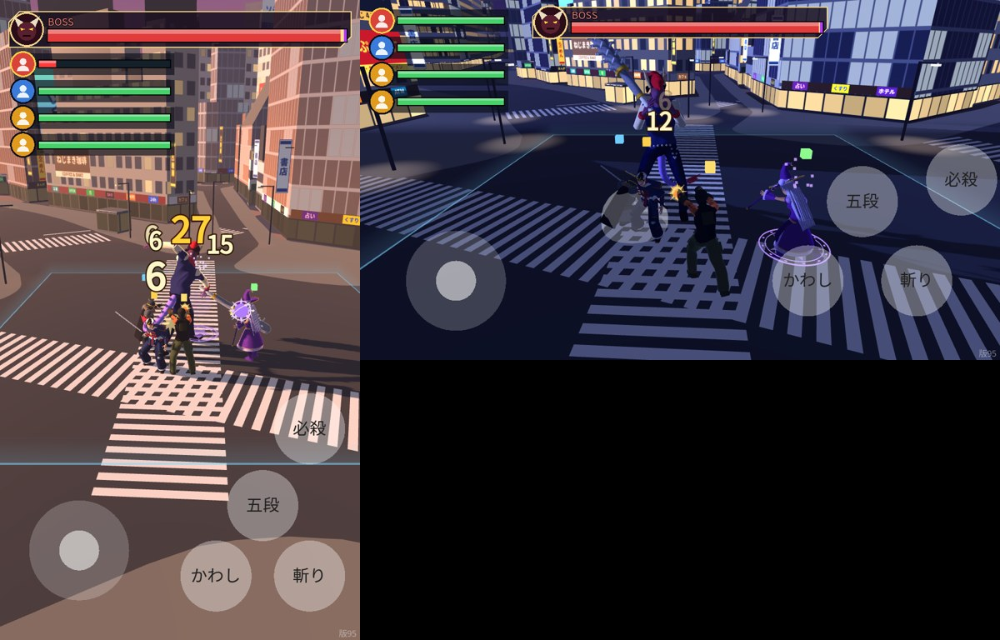

# 版95：体力の表示をバーに・戦う4人を たてに並べる（2026-10-20）

ユーザーの指示（22:29・22:33）：「HP 表示をバーにしてほしい（ボスのように）。数字はボスもキャラもいらない。戦っているキャラ4体のアイコンとバーを並べて」「縦に並べて」。

## したこと（`scripts/prototype/battle_hp_hud.gd`）
- 数字をやめた：ボスの「いま / 最大」、自分の体力の数字と「/ 最大」を出さない。
- ボス：アイコン＋メーター＋「BOSS」（覚醒は「覚醒 BOSS」・むらさき）。減った分の黄色の帯は前のまま。
- 戦う4人：自分（いちばん上・金のふち）と、なかま（AI の味方・通信のなかま）を、丸いアイコン＋体力のバーで**たてに並べる**。
  - たて画面：ボスの下の左。横画面：左上（ボスは上のまんなか）。スティック・ボタンと重ならない。
  - バーの色：緑。**体力が 30 未満は赤**（30 ちょうどは緑。版92 の決まりを、数字のかわりにバーの色で。なかまも同じ）。
  - たおれた人は、アイコンを暗く・バーは空。自分が当たった直後は、ふちが白く光る。
  - アイコン：キャラの顔の絵（ロビーと同じ係が、4人分を1回ずつ作る）。まだない時は、役の色の丸と人の形。
- 怒り・勝ち負けの文字は、表示と重ならない高さに出す（横画面は4人の列が左にあるので、ボスの下）。

## 変えたファイル
- `scripts/prototype/battle_hp_hud.gd`（数字をやめた・4人の列）
- `scripts/prototype/battle_hud.gd`（まんなかの文字の高さ）
- `scripts/prototype/stick_prototype.gd`（hud_portraits・portrait_source）
- `scripts/flow/game_flow.gd`（顔の絵の係を戦いに渡す）
- `data/prototype_stick.json`（hud.party・build_id 95）
- `tests/test_v95.gd`（新・30項目）、`tests/test_v92.gd`（新しい表示に合わせた）

## テスト
- test_v95（30）：数字を描かない／4人（自分が上・AI 3人・キャラが正しい）／30 は緑・29 は赤（なかまも）・たおれたら空／ダメージ・回復ですぐ変わる／4つの画面の形で、たてに並ぶ・場所・スティックとボタンに重ならない／通信のなかまの体力／顔の絵は1回ずつ。
- 全テスト：Godot 74本・Node 66件 合格。

## 未確認
- 実機での見やすさ（アイコンとバーの大きさ）。
