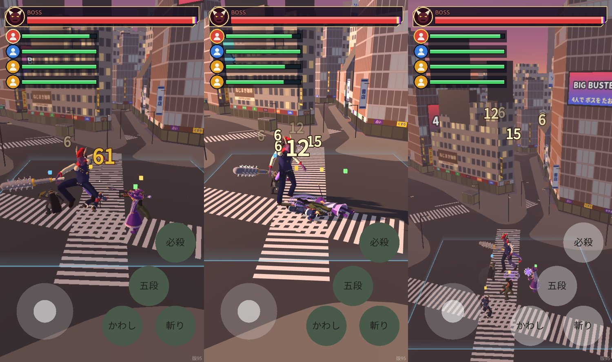

# 版97：軽量化 A-1 マップの大きな形を分ける（2026-10-20）

版96 の調査の 1 番（優先度 A）。

## 原因
- 道路（Ground）・地形（Terrain）・建物（BldgNear・BldgFar）・看板が、それぞれ**1つの大きな形**（半径 480 m 全部）だった。
  - カメラの後ろ（見えない所）も、毎コマ全部描いていた（道路の三角形の 44%）。
  - 画質「低」の「330 m より遠い建物を出さない」設定（visibility_range）は、形が1つなので、まん中からの距離で決まり、**いつも全部出ていた（効いていなかった）**。

## したこと
- `tools/plateau_to_glb.py`（split_mesh）：大きな形を3つに分けて .glb に書く（点・色・材質は同じ。分けるだけ）。
  - 前（近い）：そのままの名前（Ground など）
  - 遠い前：330 m より遠い（重心）→ `_Far`
  - 後ろ：3つの点すべてが z > 56 m → `_Back`。戦いのカメラはいつも -Z を向き、いちばん手前でも z ≈ 41 m・高さ ≈ 14 m なので、後ろの形は箱ごとカメラの後ろになり、**自動で描かれない**。
- `scripts/stage/map_loader.gd`：分けた形も元の部品と同じ材質。画質「低」では `_Far` を隠す（前の効いていなかった visibility_range のかわり）。
- 数値は data/maps.json の build.split（parts・back_z_m 56・far_m 330）。

## 結果（決まった3つの場所・夕方と夜。tools/perf_battle_fixed.gd。iPhone のたて画面 390×844・llvmpipe）
| 画質・場所 | 三角形 前 → 後 | 描画の回数 前 → 後 | 1コマ（llvmpipe）前 → 後 |
|---|---|---|---|
| 低・まん中 | 159,850 → 97,389（−39%） | 116 → 118 | 77.1 → 74.9 ms |
| 低・手前の左はし | 166,717 → 103,354（−38%） | 130 → 129 | 86.8 → 76.3 ms |
| 低・奥の右はし | 148,223 → 83,735（−44%） | 100 → 98 | 56.1 → 53.8 ms |
| 高・まん中 | 349,710 → 306,749（−12%） | 352 → 349 | 274.7 → 280.1 ms |
| 高・手前の左はし | 344,294 → 301,285（−12%） | 350 → 347 | 299.7 → 300.0 ms |
（夜も同じ傾向。llvmpipe の時間は ±7 ms ほどゆれる。へった三角形はもともと画面の外なので、CPU で描く llvmpipe の時間はあまり変わらない。スマホの GPU では、点の計算がへるぶん軽くなるはず＝未確認）

見た目は変わらない（下：低・高・上から。すきまなし）：

## テスト
- test_v97（11）：数値・同じ材質・三角形はへらない（道路 40,920 のまま）・後ろの形は全部 z > 56 m・カメラはいちばん手前でも z ≈ 41 m・自分が手前のはしにいる時も後ろの形の箱は全部カメラの後ろ・低で遠い形を隠す・高で出す・戦いの場所の床は前の形・横断歩道は1つのまま。
- test_v88 を、分けた形に合わせた（建物の場所・8方向・画質・三角形の合計は、全部の形で数える）。
- 全テスト：Godot 75本・Node 66件 合格。

## 未確認
- 実機（iPhone・Android）での FPS の変化。
