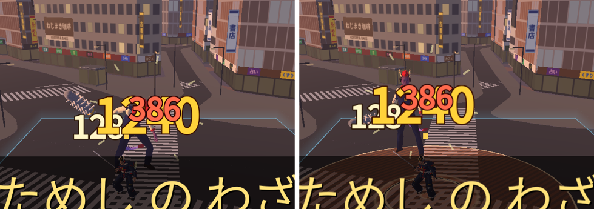

# 版99：軽量化 B-2 戦いのあとのメモリ（文字の大きさ）（2026-10-21）

版96 の調査の 4 番（優先度 B：戦いのあと、メモリが増えたまま）。

## 原因（根拠つき）
- 文字は、**大きさごとに**文字の絵（フォントのキャッシュ：大きさ1つにつき画像1枚以上）が作られ、ゲームを閉じるまで消えない。
- ダメージの数字と必殺技の名前は「はね上がり」のために、**毎コマ文字の大きさ（px）を変えていた**（`battle_hud.gd` の `_draw_damage_numbers`・`_draw_banner`）。
  60コマ/秒では、出るたびに、はね上がりの間のすべての大きさ（ふつう 42〜67 px・強い 63〜138 px・特別 67〜160 px・名前 72〜115 px）の絵が作られる。縁取りつきは、もう1枚。
- 測った（`tools/perf_fontcache.gd`：ロビー → 戦いで数字3種類と名前を10秒出し続ける → ロビー。1コマ＝1/60 秒で動かす）：

| | ロビー | 戦い（10秒） | 戦いのあとのロビー |
|---|---|---|---|
| 直す前：文字の大きさの数 | 32 | **84** | 84 |
| 直す前：文字の絵の数 | 30 | 82 | 82 |
| 直す前：メモリ（static） | 121.8 MB | **293.4 MB** | 290.2 MB |
| 直す前：画像のメモリ | 33.0 MB | **100.1 MB** | 100.1 MB |
| 直した後：文字の大きさの数 | 32 | **44** | 44 |
| 直した後：文字の絵の数 | 30 | 42 | 42 |
| 直した後：メモリ（static） | 121.8 MB | **173.4 MB** | 170.2 MB |
| 直した後：画像のメモリ | 33.0 MB | **49.4 MB** | 49.3 MB |

（この環境の描画は CPU で絵を描く llvmpipe。メモリの数はスマホのブラウザと同じではないが、増え方の比べには使える。直す前は、戦いが長いほど、まだ増える）

## したこと
- `scripts/prototype/battle_hud.gd`：
  - `pop_text(落ち着いた大きさ, いまの倍率, 段)`：倍率の段（`hud.text_pop_levels` = 1・1.45・2.1）のうち、いちばん近い段の大きさで描き、残りは拡大・縮小（0.84〜1.21 倍）でつなぐ。
  - `_scaled_string`：`draw_set_transform` で拡大・縮小して描く（縁取りもいっしょに）。
  - ダメージの数字・必殺技の名前を、これで描く。**画面での大きさ・位置・色・縁取り・動きは前と同じ**。落ち着いた時（倍率1）は、そのままの大きさ（くっきり）。
- `data/prototype_stick.json`：`hud.text_pop_levels`。
- 描く大きさの種類：ダメージの数字と名前で **79 → 10 種類**（test_v99 の計算。1/60・1/37・1/23 秒ずつ進めた時）。

## 道具
- `tools/perf_fontcache.gd`（測るだけ）・`tools/shot_text_pop.gd`（はね上がりの写真）。

## テスト
- test_v99（9）：段は data・画面での大きさは前と同じ・倍率1はそのまま・拡大縮小は 0.8〜1.25 倍・種類が減る（ふつう 14→2・強い 23→3・特別 26→3・名前 16→2・全部 79→10）。
- 全テスト：Godot 77本・Node 66件 合格。

## 未計測
- 実機（iPhone・Android のブラウザ）でのメモリ。拡大・縮小した時の文字のくっきりさ（写真では差は見えない）。
